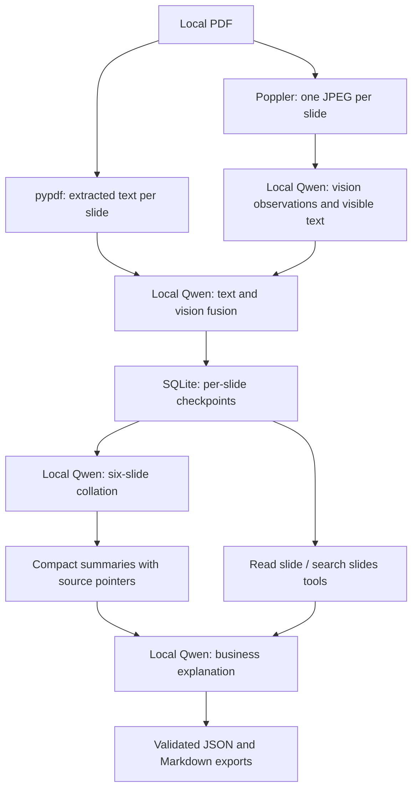

# Architecture

## Components

`diligence/store.py` handles PDF ingestion, rendering, immutable source hashes and checkpoint storage. Rendered slides have a maximum dimension of 1800 pixels. Very small chart labels may still be unreadable; Qwen must report uncertainty. Neither OCR nor diagram parsing is outsourced.

`diligence/lm.py` is the loopback LM Studio client. It uses OpenAI-compatible chat completions, multimodal image input, JSON-schema response formats and function calling. It does not use a cloud SDK or hidden fallback model. The model ID is explicit for every request. A timeout or truncated response stops the run at the last saved checkpoint.

`diligence/agent.py` orchestrates sequential stages. Only validated JSON becomes persistent state. Vision and fusion have no history from other slides. Batch summaries preserve original slide pointers and the synthesis retains access to full saved interpretations through tools. Large summary sets are recursively compressed with the same local model. The explanation attributes claims to the deck; it is not an independent diligence verdict.

`diligence/tools.py` contains two small read-only retrieval functions. Input types and unknown properties are checked at execution. A tool cannot run a shell, open arbitrary paths, contact external services, or read another deck.

`diligence/server.py` serves the browser app and JSON API on loopback. There is one background model worker. Cancellation is cooperative at inference boundaries. A completed vision stage or slide interpretation survives subsequent failures. Resuming a run retains its source snapshot and model ID. Keep only one app process per data directory.

`web/` provides the local UI. Slide text and generated responses are inserted with `textContent`. A restrictive content security policy and origin/token checks keep webpage content from invoking privileged tools. Full reports and traces are available only through the local app and exports.

## Adding later workflows

Keep face-value deck understanding as a separate evidence layer. A later critical analysis workflow should retrieve these slide interpretations and independently supplied evidence with explicit source types, dates, assumptions and confidence. Do not mix market research or investment scores into this first-stage explanation.

Start with retrieval-quality and output-schema evaluations on synthetic fixtures. For real decks, evaluate counts, schema validity, missing slides, valid citations and stage latency without sending private content to a cloud model. Business-content quality must be reviewed by the user or the local model.
